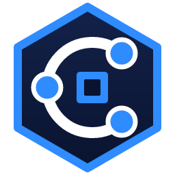

# Coiman IDE



A lightweight code editor and IDE written in Rust with [egui](https://github.com/emilk/egui):
language servers, debugging, Git, run configurations, Maven, and the VS Code themes,
snippets and language servers you already have.

The code font is `editor.font_family`: any fixed-width font installed on the computer, picked in
Settings, or a path to a font file.

Settings (`Ctrl+,`) and keyboard shortcuts (`Ctrl+K Ctrl+S`) each have a window, so no file editing
is needed; **Edit as File** still opens the TOML behind them.

`<config>` below is your config folder: `%APPDATA%\coiman-ide` on Windows (a `rust-code` folder from before the rename is moved there on first start),
`$XDG_CONFIG_HOME/coiman-ide` or `~/.config/coiman-ide` elsewhere.

## Install

Coiman never updates itself and opens no connection to look for updates. Updates come the way
Coiman came, when you ask for them.

Windows, from the [releases page](https://github.com/ManuelCoimbra/coiman-ide/releases):

- **Setup program** (`coiman-ide-<version>-windows-x64-setup.exe`): installs for you alone
  (no administrator rights) or for everyone, with a Start menu entry. To update, run the
  newer version's setup: it replaces the older one in place. Uninstall from Settings > Apps.
- **Scoop**: `scoop install https://github.com/ManuelCoimbra/coiman-ide/releases/latest/download/coiman-ide.json`,
  then `scoop update coiman-ide`. Scoop reads that address again to find the newest version.
- **Zip** (`coiman-ide-<version>-windows-x64.zip`): unpack anywhere and run `coiman-ide.exe`.
  To update, unpack the newer zip in its place.

None of these touch your settings (`%APPDATA%\coiman-ide`), and uninstalling keeps them.

Linux also has a signed APT and RPM repository ([docs/INSTALL-LINUX.md](docs/INSTALL-LINUX.md)).
winget is waiting for its first review; the Snap Store and the AUR are ready in the release
workflow but not set up yet ([docs/PUBLISHING.md](docs/PUBLISHING.md)).

Linux: deb, rpm, AppImage (updated by AppImageUpdate), Flatpak, Snap, Arch PKGBUILDs and a
tar.gz, for x86_64 and ARM64; see
[docs/INSTALL-LINUX.md](docs/INSTALL-LINUX.md) for installing, updating and removing each.

## Build, run and test

You need Rust (stable, edition 2024). On Windows the GNU toolchain is used, and MinGW's
`windres` (MSYS2: `pacman -S mingw-w64-ucrt-x86_64-binutils`) puts the icon into the
program; without it the program builds without its icon in the file.

```
cargo run --release -- [folder-or-file]
```

On Linux, the build needs a C compiler, `pkg-config` and the Wayland, xkbcommon, X11 and
OpenGL development files (Debian and Ubuntu: `build-essential pkg-config libwayland-dev
libxkbcommon-dev libx11-dev libxcursor-dev libxrandr-dev libxi-dev libgl1-mesa-dev`).

The program is `target/release/coiman-ide.exe` (`coiman-ide` on Linux). Tests and lints, as the checks run them:

```
cargo test --workspace
cargo clippy --all-targets
powershell -File scripts/check.ps1
```

## Theme

**Coiman Dark** is the default theme, in the icon's colors: navy, electric blue and white.
Dark Modern, Light Modern and any VS Code theme are in **Preferences: Color Theme**.

## Icon

`assets/icon/coiman.svg` is the icon: a hexagon, three linked nodes making a C, and a small
square for the editor, in navy, electric blue and white. The PNGs (16 to 1024 pixels) and
`coiman.ico` beside it are made from it:

```
cargo run --release --example make_icons
```

## Project structure

A Cargo workspace. [docs/ARCHITECTURE.md](docs/ARCHITECTURE.md) explains how the parts fit.

```
crates/
  coiman-core/   everything that needs no UI, tested and benchmarked headlessly
  coiman-ide/    the egui app: the window, its panels and widgets
  coiman-plugin/ the plugin publisher's tool: keys, components, signing, registries
plugins/
  built-in/      plugins shipped inside the app (WebAssembly)
  extensions/    the extensions that come with Coiman, one per feature, installed by pack
  examples/      example plugins
assets/icon/     the icon: coiman.svg and what is made from it
docs/            features, architecture, the audit
scripts/         checks, benchmarks, plugin builds, data generators
```

Checks (no networking crates, formatting, clippy with warnings as errors, tests):

```
powershell -File scripts/check.ps1
```

`cargo lint` runs just clippy for the workspace.

Benchmarks against the performance targets (keystroke latency, incremental reparse, line
commands, large-file open, Quick Open over 100k files, startup time, idle memory):

```
powershell -File scripts/bench.ps1 [-Quick]
```

`cargo bench -p coiman-core` runs only the headless part. Each row prints p50/p99 and
PASS, FAIL or GAP; a GAP is a known shortfall tracked on the roadmap and doesn't fail the run.

## Privacy

No telemetry, no account, no built-in AI, and no connection unless you ask for one (the Open
VSX marketplace, a language server's install, Git's push and pull). VS Code extensions' own
code runs only if you turn it on, for trusted folders. The optional Agents panel uses
the `opencode` program you install yourself, and asks before the agent edits or runs anything. See [PRIVACY.md](PRIVACY.md) for what
is read and written on your machine.

## Features

Language servers for a dozen languages, debugging (CodeLLDB, debugpy, Delve, js-debug, gdb), Git,
run configurations and tests for every language, Cargo and Maven, Vim and Helix modes, local
history, live previews, WebAssembly plugins, and the VS Code themes, snippets and extensions you
already have. [docs/FEATURES.md](docs/FEATURES.md) has all of it.

## Contributing

See [CONTRIBUTING.md](CONTRIBUTING.md). Changes are listed in [CHANGELOG.md](CHANGELOG.md).

## Thanks

Thank you to everyone who has helped Coiman IDE along:

- [probonopd](https://github.com/probonopd), creator of AppImage, for adding Coiman IDE to the
  [AppImageHub](https://appimage.github.io) catalog
  ([AppImage/appimage.github.io#12471](https://github.com/AppImage/appimage.github.io/pull/12471)).
  The review that came with it led to the light theme by default and to AppImage updates
  through AppImageUpdate.
- [MostafaXS1](https://github.com/MostafaXS1), for the Android build: the APK port in
  [artcraft-android](https://github.com/MostafaXS1/artcraft-android) that runs Coiman IDE on
  Android, and the testing that shaped the porting hooks in [docs/PORTING.md](docs/PORTING.md);
  and for the Open VSX marketplace, VS Code extensions with their webviews and language
  servers, Prettier and Biome formatting, sticky scroll, the find box, fuzzy completion and
  the reworked Agents panel.
- Everyone who starred, tried or shared the project.

## License

[MIT](LICENSE).
