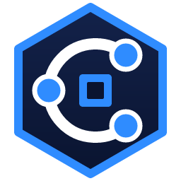

# Coiman IDE



A lightweight code editor and IDE written in Rust with [egui](https://github.com/emilk/egui):
language servers, debugging, Git, run configurations, Maven, and the VS Code themes,
snippets and language servers you already have.

The code font is `editor.font_family`: any fixed-width font installed on the computer, picked in
Settings, or a path to a font file.

Settings (`Ctrl+,`) and keyboard shortcuts (`Ctrl+K Ctrl+S`) each have a window, so no file editing
is needed; **Edit as File** still opens the TOML behind them.

`<config>` below is your config folder: `%APPDATA%\coiman-ide` on Windows (a `rust-code` folder from before the rename is moved there on first start),
`$XDG_CONFIG_HOME/coiman-ide` or `~/.config/coiman-ide` elsewhere.

## Build, run and test

You need Rust (stable, edition 2024). On Windows the GNU toolchain is used, and MinGW's
`windres` (MSYS2: `pacman -S mingw-w64-ucrt-x86_64-binutils`) puts the icon into the
program; without it the program builds without its icon in the file.

```
cargo run --release -- [folder-or-file]
```

The program is `target/release/coiman-ide.exe`. Tests and lints, as the checks run them:

```
cargo test --workspace
cargo clippy --all-targets
powershell -File scripts/check.ps1
```

## Theme

**Coiman Dark** is the default theme, in the icon's colors: navy, electric blue and white.
Dark Modern, Light Modern and any VS Code theme are in **Preferences: Color Theme**.

## Icon

`assets/icon/coiman.svg` is the icon: a hexagon, three linked nodes making a C, and a small
square for the editor, in navy, electric blue and white. The PNGs (16 to 1024 pixels) and
`coiman.ico` beside it are made from it:

```
cargo run --release --example make_icons
```

## Project structure

A Cargo workspace. [docs/ARCHITECTURE.md](docs/ARCHITECTURE.md) explains how the parts fit.

```
crates/
  coiman-core/   everything that needs no UI, tested and benchmarked headlessly
  coiman-ide/    the egui app: the window, its panels and widgets
  rcplugin/      the plugin publisher's tool: keys, components, signing, registries
plugins/
  built-in/      plugins shipped inside the app (WebAssembly)
  examples/      example plugins
assets/icon/     the icon: coiman.svg and what is made from it
docs/            features, architecture, the audit
scripts/         checks, benchmarks, plugin builds, data generators
```

Checks (no networking crates, formatting, clippy with warnings as errors, tests):

```
powershell -File scripts/check.ps1
```

`cargo lint` runs just clippy for the workspace.

Benchmarks against the performance targets (keystroke latency, incremental reparse, line
commands, large-file open, Quick Open over 100k files, startup time, idle memory):

```
powershell -File scripts/bench.ps1 [-Quick]
```

`cargo bench -p coiman-core` runs only the headless part. Each row prints p50/p99 and
PASS, FAIL or GAP; a GAP is a known shortfall tracked on the roadmap and doesn't fail the run.

## Privacy

No telemetry, no network access, no account, no AI. See [PRIVACY.md](PRIVACY.md) for what
is read and written on your machine.

## Features

Language servers for a dozen languages, debugging (CodeLLDB, debugpy, Delve, js-debug, gdb), Git,
run configurations and tests for every language, Cargo and Maven, Vim and Helix modes, local
history, live previews, WebAssembly plugins, and the VS Code themes, snippets and extensions you
already have. [docs/FEATURES.md](docs/FEATURES.md) has all of it.

## Contributing

See [CONTRIBUTING.md](CONTRIBUTING.md). Changes are listed in [CHANGELOG.md](CHANGELOG.md).

## License

[MIT](LICENSE).
